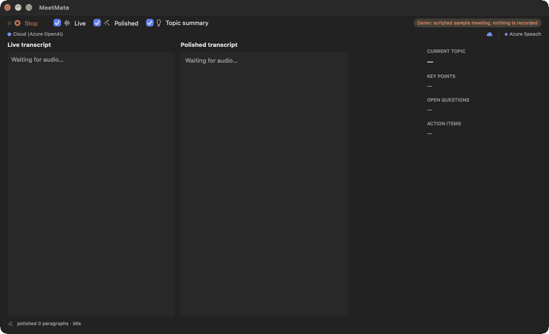
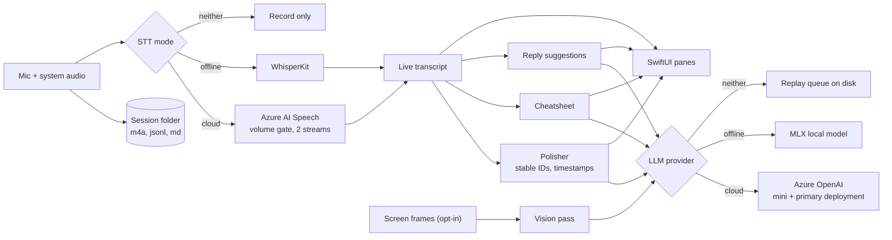

# MeetMate

[](https://github.com/Mingz6/MeetMate/actions/workflows/ci.yml)
[](LICENSE)

A macOS meeting assistant. It listens to your mic and to the meeting app's audio, writes a live transcript, polishes it into timestamped paragraphs, and keeps a cheatsheet (topic, key points, open questions, action items) beside it.

Name the user in the call and it drafts a reply. Speech-to-text (STT) and the language model run on Azure by default, with WhisperKit and an MLX model on the Mac as the fallback.



*That is `--demo` mode: a scripted, made-up meeting replayed through the real views. Nothing is recorded and no Azure account is needed.*

## Why I built it

On 2026-04-22 I ran a paper-reading meeting on local Whisper plus a local model. The laptop throttled during polishing and the live transcript almost got lost.

So the design flipped: use Azure for speech and language, and write the audio to disk first no matter what happens to the network. If the cloud drops, MeetMate keeps recording and replays the queued polish jobs when it comes back. The on-device models are the fallback, not the default.

## Quickstart (fresh clone, no keys)

You need macOS 14 or newer and Xcode 26 or newer. CI builds with Xcode 26.6; I also built it from a fresh clone with Xcode 27.2.

```bash
# One time. Xcode 26+ ships the Metal toolchain as a separate download, and the MLX package needs it.
xcodebuild -downloadComponent MetalToolchain

git clone https://github.com/Mingz6/MeetMate.git
cd MeetMate
xcodebuild -project MeetMate.xcodeproj -scheme MeetMate -configuration Debug \
  -destination 'platform=macOS' -derivedDataPath build CODE_SIGNING_ALLOWED=NO build
open build/Build/Products/Debug/MeetMate.app --args --demo
```

The first build fetches and compiles WhisperKit and MLX, so give it several minutes. Later builds are fast.

Run the unit tests (the UI tests need a GUI session, so I skip them here and in CI):

```bash
xcodebuild -project MeetMate.xcodeproj -scheme MeetMate -destination 'platform=macOS' \
  -derivedDataPath build CODE_SIGNING_ALLOWED=NO -skip-testing:MeetMateUITests test
```

### Using it for real

Open `MeetMate.xcodeproj` in Xcode, pick your own signing team, and run. Open Settings, paste your Azure OpenAI endpoint, deployment names and key, plus your Azure AI Speech region and key. They go in the Keychain. macOS asks for microphone access on the first recording, and for screen recording if you want system audio. Details and troubleshooting are in [docs/setup.md](docs/setup.md).

Heads up: the app loads its local models at every launch, even with Azure configured. The first launch downloads WhisperKit `large-v3` (about 3 GB) and an MLX model sized to your RAM (1 to 8 GB). `--demo` skips all of that.

## What it does

- **Live transcript.** Azure AI Speech over a WebSocket, with the mic and the system audio on separate recognizers so each side is tagged `me` or `remote`. A volume gate keeps silence off the wire.
- **Polished transcript.** Every 25 seconds the new text is turned into paragraphs with `[mm:ss]` stamps. Click a stamp to seek the saved audio. Later passes can propose a revision; you accept or reject it, and the paragraph keeps its ID with a bumped version.
- **Cheatsheet.** Current topic, key points, open questions and action items, refreshed every 30 seconds. With screen capture on, a vision pass adds what is on the shared slide.
- **Reply suggestions.** When the transcript names you, it drafts a two or three sentence answer and shows it above the cheatsheet.
- **After the meeting.** A second, full-audio transcription (Azure Fast Transcription, with speaker labels) is offered as an accept-or-keep diff. Accepting keeps the existing paragraph IDs.
- **Offline.** No network, or three failed cloud calls in a row: audio and the raw transcript keep saving, polish jobs queue on disk and replay later.

## Architecture



More detail in [docs/architecture.md](docs/architecture.md).

## Stack

| Part | Choice |
|---|---|
| UI | SwiftUI, SwiftData. macOS 14+ is the active target. The iOS and iPadOS targets (project deployment target 26.4) only have a mic-only `RecordView` and are not built in CI |
| STT, primary | Azure AI Speech, a plain Swift WebSocket client (no Speech SDK) |
| STT, fallback | [WhisperKit](https://github.com/argmaxinc/WhisperKit) |
| LLM, primary | Azure OpenAI chat completions, routed per task: polish and cheatsheet go to a cheaper mini deployment |
| LLM, fallback | [mlx-swift-examples](https://github.com/ml-explore/mlx-swift-examples), model picked by RAM (Qwen3 4B or 14B, Llama 3.1 8B) |
| Audio | AVAudioEngine for the mic, ScreenCaptureKit for system audio and screen frames, AVCaptureSession for the webcam |
| Secrets | Keychain, never UserDefaults |
| CI | GitHub Actions on `macos-26`, Xcode 26.6 |

## Status

The macOS app works end to end on my Mac. Everything in sections 1 to 7 of the [roadmap](docs/ROADMAP.md) is done: auto-save, cloud LLM with offline fallback, pre-meeting context, video capture, stable paragraph IDs, re-polish, and the Azure Speech pipeline. Still open: iOS and iPadOS polish, iCloud sync, a model download manager, and a real icon.

Tests: 22 unit tests cover the pure logic (volume gate, vocabulary extraction, paragraph contract, task routing, token cost, the demo script). The Azure calls have no tests, because they need real credentials. The Xcode template UI tests are not run in CI.

## Decisions and trade-offs

- **Cloud first, local second.** Azure is faster and more accurate than a laptop under load, but audio leaves the machine. The local path stays in as a safety net. The cost is that the app loads those local models at launch whether or not you need them. A switch for that is not built yet.
- **No Speech SDK.** Azure Speech is a hand-written WebSocket client. One less native dependency to ship, and I own the retry and framing code.
- **A plain volume gate, not a neural VAD.** An RMS (root mean square) threshold with a hangover cuts what gets sent to Azure. It misjudges loud background noise. Swapping in Silero is noted in `VADGate.swift`.
- **The app assigns paragraph IDs, not the LLM.** Models forget IDs between calls. IDs are `p_000001` and up, never reused, and revisions append a new version instead of overwriting.
- **Mic and system audio stay in two files.** Once mixed, they cannot be separated again, and the two Azure recognizers need them apart.
- **The post-meeting transcript never overwrites the live one.** It lands in separate files until you accept it.
- **API keys, not Entra ID.** Signing in with `az login` adds too much friction for a desktop app. The key sits in the Keychain.
- **WhisperKit tracks its `main` branch,** because no release tag resolves against the `swift-transformers` that mlx-swift-examples 2.29.1 needs. I commit `Package.resolved` so the build is repeatable, and the CI cache keys off it.
- **Stale async work is made harmless with a session token.** Every start or stop bumps a counter, and each `await` checks it before writing state. `Task.cancel()` alone lets a late result overwrite a new session.

## Privacy

With cloud mode on:

- Audio streams to Azure AI Speech for transcription. The post-meeting pass uploads the whole audio file to Azure's Fast Transcription API.
- Transcript text, and screen frames if you turn screen capture on, go to Azure OpenAI. Check your own resource's data-handling terms; I have not audited them for you.
- There is no telemetry and no analytics SDK. The only other network traffic is the first-launch model download from Hugging Face.
- In local mode nothing leaves the Mac.

Credentials live in the Keychain. Sessions are saved under `MeetMate/Sessions/` in the app's Documents folder (inside the sandbox container for a signed build).

## Docs

- [docs/ROADMAP.md](docs/ROADMAP.md): forward work and what shipped
- [docs/architecture.md](docs/architecture.md): components, data flow, platform matrix
- [docs/setup.md](docs/setup.md): signing, first run, troubleshooting

## License

[MIT](LICENSE)
