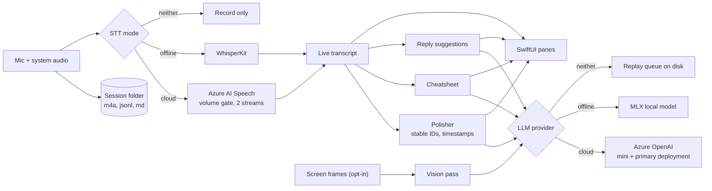

# Architecture

## Threading model

- **Main actor:** all UI and service coordinators. The app target builds with main-actor default isolation.
- **Background:** audio capture (AVAudioEngine has its own thread), WhisperKit inference, MLX inference, the Azure WebSocket.
- Cross-actor communication goes through `@Published` properties and Swift concurrency. Long-running loops use a session token so a stale result cannot overwrite a newer session (`sessionToken` in `TranscriptionService`, `TranscriptPolisher`, `CheatsheetGenerator`, `ReplyGenerator`).

## Data flow

1. `AudioCaptureService` produces mic and system-audio buffers as separate streams.
2. Both streams are written incrementally to `mic.m4a` and `system.m4a` in the session folder, and routed to `TranscriptionService`.
3. In cloud mode each stream passes a `VADGate` (silence stays off the wire) and goes to its own `AzureSpeechSTT` recognizer. In local mode the audio is mixed into a rolling buffer and decoded by WhisperKit every 1.5 seconds, a segment counting as confirmed after two identical decodes.
4. Confirmed segments append to the live transcript and to `transcript.jsonl`.
5. `TranscriptPolisher` runs every 25 seconds. It sends the new segments to the LLM and gets back paragraph boundaries. Swift assigns the IDs (`p_000001` and up) and the timestamps, and writes `polished.md` and `paragraphs.jsonl`. Every third cycle it asks for revisions to the last five paragraphs, which show up as accept or reject cards.
6. `CheatsheetGenerator` refreshes every 30 seconds into `cheatsheet.md`.
7. `ReplyGenerator` checks the last 800 characters every 2 seconds for the user's name, with a 15 second cooldown, and drafts a 2 to 3 sentence reply.
8. With screen capture on, `FrameCaptureService` saves JPEG frames and `VisionService` adds a description of the slide to the cheatsheet. Vision is cloud-only.
9. `LLMService` picks the provider per call: Azure OpenAI, else the local MLX model, else it throws and the job goes to `ReplayQueue`. `ReachabilityMonitor` flips to "record only" after three failures in a row or when the network path drops, and drains the queue when the cloud is back.
10. On stop, `BatchReTranscriber` re-transcribes the saved audio (Azure Fast Transcription with speaker labels, or WhisperKit when no Azure keys are set) into `transcript.batch.jsonl`. Accepting it replaces the live segments and re-polishes with the existing paragraph IDs kept.

The meeting saves to disk while it runs, not only on stop, so a crash keeps the last flush. Turn "Save this meeting" off before recording to skip it.

## Demo mode

`MeetMateApp` shows `DemoMeetingView` instead of `MainView` when launched with `--demo`. `DemoScript` is a list of steps that mutate a `DemoState`, and `DemoPlayer` applies one every 1.6 seconds (`-demoInterval` changes it). The panes are the live app's own views, so the demo cannot drift from the real layout. It never touches the microphone, the Keychain, the network or the model download.

## Cross-platform

One codebase. macOS is the active target. The iOS and iPadOS targets keep a mic-only `RecordView`. Design rule: no macOS-only data models, and no packages that cannot compile on iOS.

| Concern | macOS (active) | iPadOS and iOS (deferred) |
|---|---|---|
| Status | Working | Mic-only `RecordView` exists, polish pipeline is macOS first |
| System audio | ScreenCaptureKit | Not available, mic only |
| Window | Regular window | Full screen or Slide Over |
| Background recording | Always allowed | Needs a `.playAndRecord` audio session and the Background Modes capability |
| Settings | Separate Settings scene | Sheet inside the main view |
| Cloud STT and LLM (Azure) | Full | Full |
| Local WhisperKit and MLX | Full | Newer chips only |
